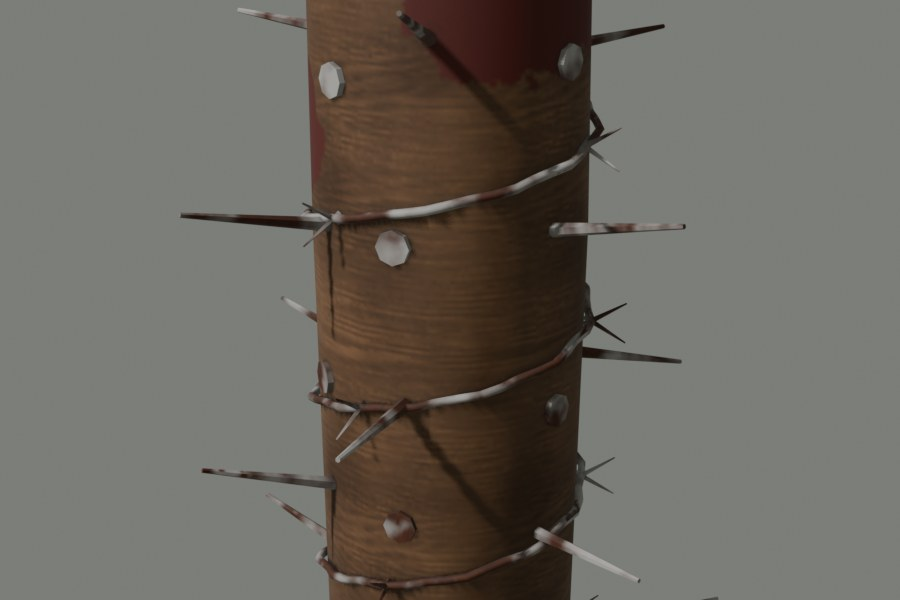
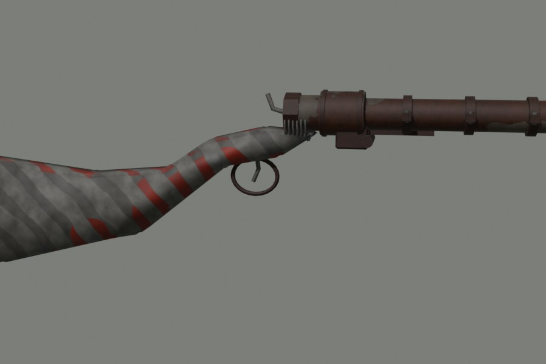
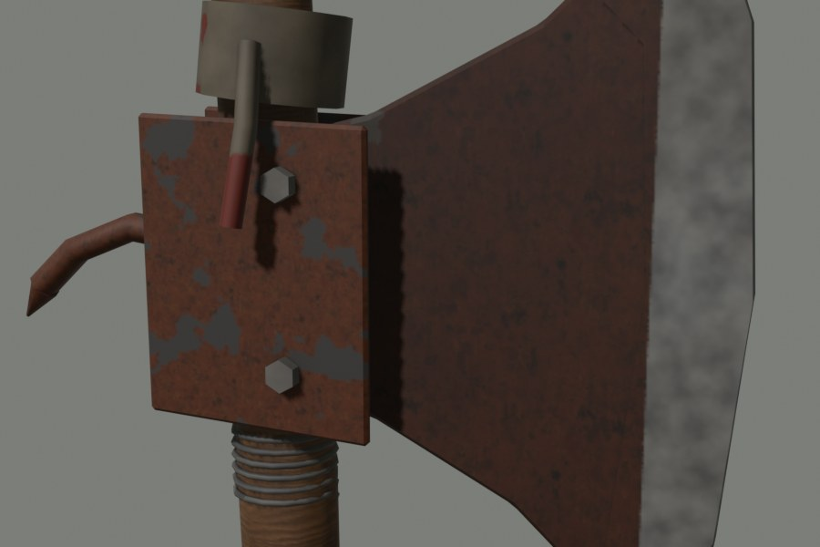
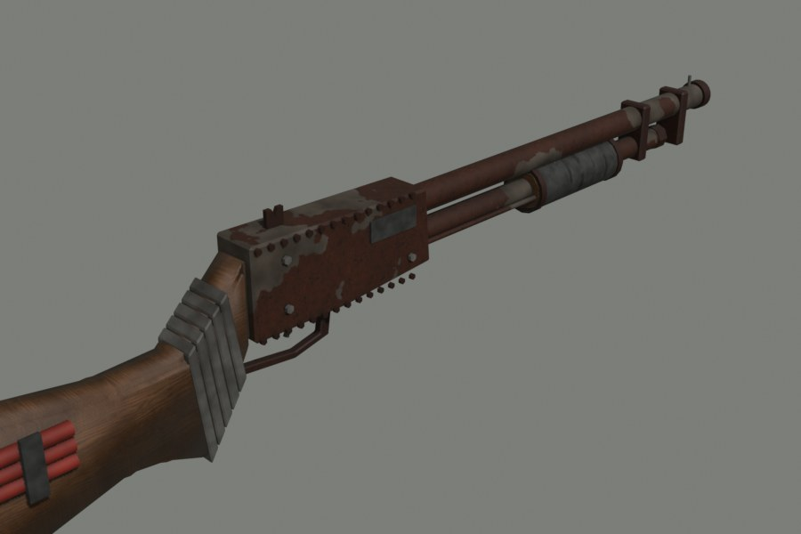
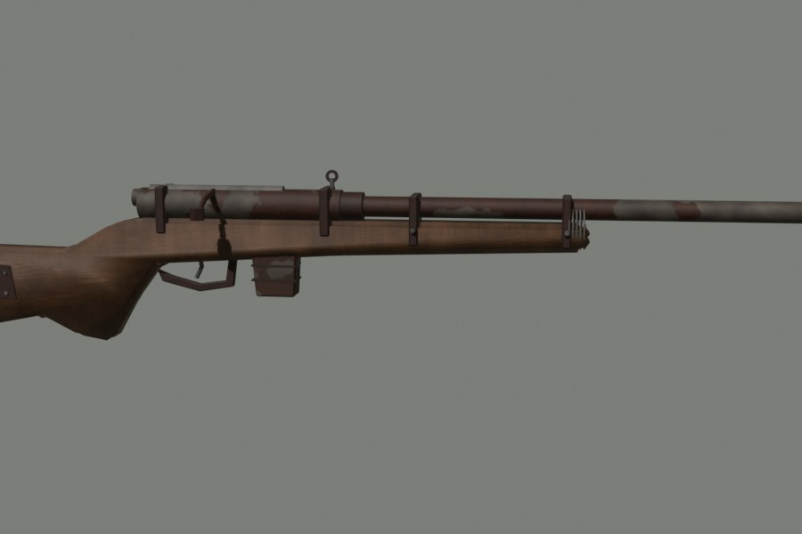
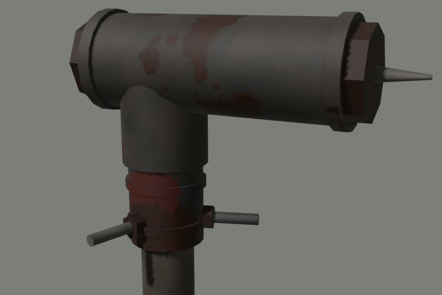
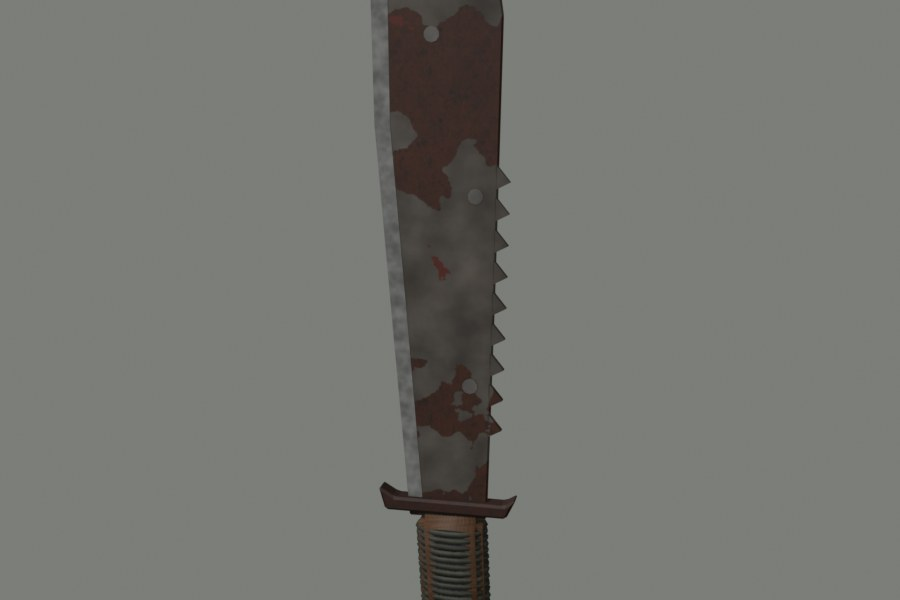
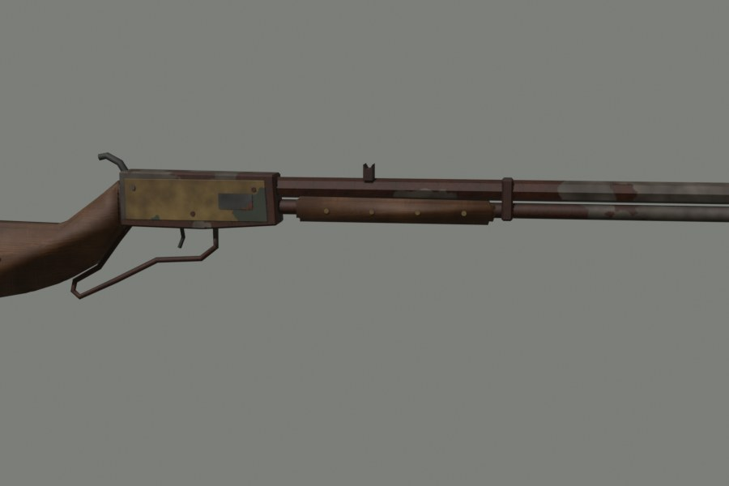
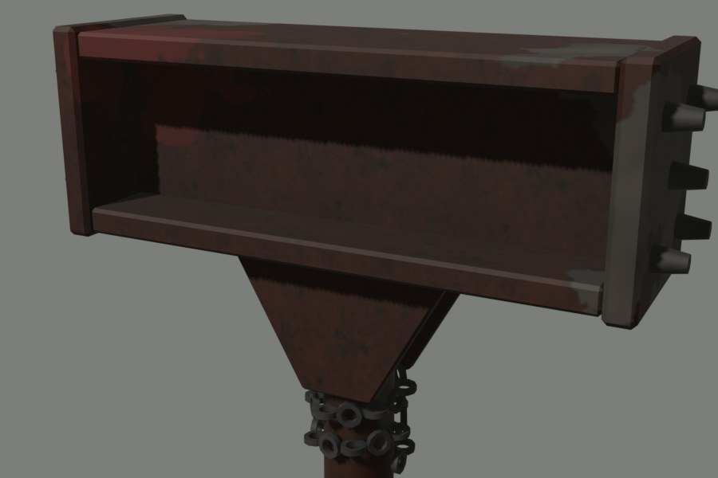
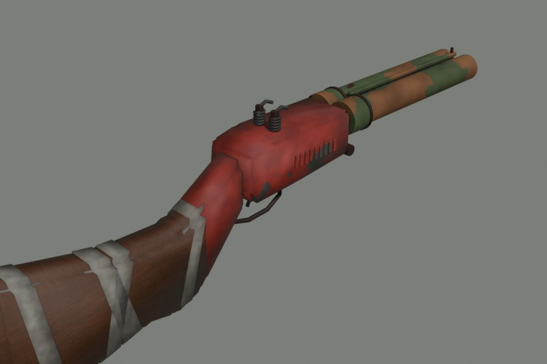

# Scrap weapons (wasteland_scrapweapons)

Home-made weapons with their own models, added **one weapon at a time**. Each
one is tested in-game and approved before the next is started.

## How it fits in

The resource only brings the weapons; everything else is the framework's:

| What | Who does it |
|---|---|
| Model (`stream/*.ydr`, `*.ytd`) and weapon data (`meta/*.meta`) | `wasteland_scrapweapons` |
| The item (size, weight, durability, icon) | registered with `wasteland_inventory` (`RegisterItem`) |
| Holding, ammo from the inventory, wear, repairs, zombie noise | registered with `wasteland_weapons` (`RegisterWeapon`) |
| Recipe | registered with `wasteland_crafting` (`RegisterRecipe`) |
| Saving, dropping, trading, death drops | the inventory, like any item |
| Icon pictures | `wasteland_images/html/images/<item>.webp` (+ `index.txt`) |

Nothing is added to your config files, so updates never need merging. A
weapon or recipe of the same name in `weapons.lua` / `crafting.lua` wins over
the one registered here.

Item names start with `scrap_`; weapon names with `WEAPON_WL_`.

## Limits of the game (no custom animation files)

* Animations are GTA's own: each weapon borrows those of a GTA weapon.
  Pump shotgun: real pump. Double-barrel: real break-open reload. Bolt and
  lever rifles: rifle handling; the cycle between shots is fire rate + sound,
  the hands do not work a bolt or lever. The maul swings like the bat.
* Sounds are GTA's own sound sets for now (custom audio is a later step).
* Concept art and icons are renders of the actual model.

## Status

| # | Weapon | Item | Status |
|---|---|---|---|
| 0 | Foundation (resource, registration exports) | - | approved (tested on the server) |
| 1 | Spiked Baseball Bat | `scrap_spiked_bat` | approved (tested on the server) |
| 2 | Pipe Shotgun | `scrap_pipe_shotgun` | approved (tested on the server) |
| 3 | Scrap-Made Axe | `scrap_axe` | approved (tested on the server) |
| 4 | Scrap Pump Shotgun | `scrap_pump_shotgun` | approved (tested on the server) |
| 5 | Scrap Bolt Rifle | `scrap_bolt_rifle` | approved (tested on the server) |
| 6 | Pipe Club | `scrap_pipe_club` | approved (tested on the server) |
| 7 | Scrap Machete | `scrap_machete` | approved (tested on the server) |
| 8 | Scrap Lever Rifle | `scrap_lever_rifle` | approved (tested on the server) |
| 9 | Heavy Scrap Maul | `scrap_maul` | approved (tested on the server) |
| 10 | Improvised Double-Barrel | `scrap_double_barrel` | **awaiting your test** |

Order note: the Spiked Bat is first because a melee weapon has no muzzle,
ammo or reload, so it proves the whole addon-weapon chain with the fewest
moving parts.

## 1. Spiked Baseball Bat



| | |
|---|---|
| Item | `scrap_spiked_bat` (1 x 4, 0.7 kg, 300 hits durability) |
| Game weapon | `WEAPON_WL_SPIKEDBAT`, model `wl_w_me_spikedbat` |
| Based on | `WEAPON_BAT`: same two-handed swings, blocking, first person |
| Damage | 1.35 x the bat (client `SetWeaponDamageModifier`) |
| Noise | 10 m (zombies) |
| Recipe | Baseball bat + 10 nails + 1 scrap metal + 1 duct tape, 8 s, no blueprint |
| Model | 4,596 triangles, one 1024 texture (embedded), the bat's bones and collision |

Build (needs the game's `w_me_bat.ydr`, exported with CodeWalker, and the
ambientCG textures Wood049 and Rust004):

```
blender -b --python tools/scrapweapons/build_spiked_bat.py -- <tex> <out>
python tools/scrapweapons/dds_mips.py <out>/spiked_bat_d.png <out>/spiked_bat_d.dds
blender -b --python tools/scrapweapons/export_weapon.py -- <w_me_bat.ydr> <out> spiked_bat wl_w_me_spikedbat
python tools/scrapweapons/make_meta.py <game data> WEAPON_BAT WEAPON_WL_SPIKEDBAT wl_w_me_spikedbat WT_WL_SPKBAT <meta out>
```

## 2. Pipe Shotgun



| | |
|---|---|
| Item | `scrap_pipe_shotgun` (4 x 2, 1.4 kg, 120 shots durability, wear 2 per shot) |
| Game weapon | `WEAPON_WL_PIPESHOTGUN`, model `wl_w_sg_pipeshotgun` |
| Based on | `WEAPON_DBSHOTGUN` (sawed-off): its handling, damage, sound and break-open reload; clip 1 shell |
| Ammo | `ammo_12g` from the inventory |
| Noise | 180 m (zombies) |
| Recipe | 6 scrap metal + 1 wood planks + 4 nails + 2 duct tape, 12 s, no blueprint |
| Model | 3,484 triangles (v2: long rusty barrel with clamp rings, taped rifle stock, after the first look was rejected); the barrel is on the hinge bone (opens on reload), trigger on the trigger bone |

Build (game files: `w_sg_doublebarrel.ydr`; the DLC data `weapondbshotgun.meta`,
`weaponanimations.meta`, `weaponarchetypes.meta` from mplowrider2, as weapons.meta etc.):

```
blender -b --python tools/scrapweapons/build_pipe_shotgun.py -- <tex> <out>
python tools/scrapweapons/dds_mips.py <out>/pipe_shotgun_d.png <out>/pipe_shotgun_d.dds
blender -b --python tools/scrapweapons/export_weapon.py -- <w_sg_doublebarrel.ydr> <out> pipe_shotgun wl_w_sg_pipeshotgun
python tools/scrapweapons/make_meta.py <dlc data> WEAPON_DBSHOTGUN WEAPON_WL_PIPESHOTGUN wl_w_sg_pipeshotgun WT_WL_PIPESG <meta out> ClipSize=1
```

## 3. Scrap-Made Axe



| | |
|---|---|
| Item | `scrap_axe` (1 x 3, 0.9 kg, 350 hits durability) |
| Game weapon | `WEAPON_WL_SCRAPAXE`, model `wl_w_me_scrapaxe` |
| Based on | `WEAPON_HATCHET`: same one-handed swings |
| Damage | 1.2 x the hatchet |
| Recipe | 4 scrap metal + 1 log + 2 nails + 1 rag + 1 duct tape, 10 s |
| Model | 2,952 triangles |

Build: `build_scrap_axe.py`, then `export_weapon.py -- <w_me_hatchet.ydr> <out> scrap_axe wl_w_me_scrapaxe`,
`make_meta.py <spupgrade data> WEAPON_HATCHET WEAPON_WL_SCRAPAXE wl_w_me_scrapaxe WT_WL_SCRAPAXE <meta>`
(game data: weaponhatchet.meta as weapons.meta, and the spupgrade weaponanimations / weaponarchetypes).

## 4. Scrap Pump Shotgun



| | |
|---|---|
| Item | `scrap_pump_shotgun` (5 x 2, 2.2 kg, 250 shots durability) |
| Game weapon | `WEAPON_WL_SCRAPPUMP`, model `wl_w_sg_scrappump` |
| Based on | `WEAPON_PUMPSHOTGUN`: its handling, damage, sound and pump animation (the pump is on Gun_Cock1, so it slides); 4 shells |
| Ammo | `ammo_12g` |
| Recipe | 10 scrap metal + 2 metal sheet + 2 wood planks + 4 nails + 2 duct tape, 15 s |
| Model | 3,196 triangles |

Build: `build_scrap_pump.py`, then `export_weapon.py -- <w_sg_pumpshotgun.ydr> <out> scrap_pump wl_w_sg_scrappump`,
`make_meta.py <update.rpf data> WEAPON_PUMPSHOTGUN WEAPON_WL_SCRAPPUMP wl_w_sg_scrappump WT_WL_SCRAPPUMP <meta> ClipSize=4`.

## 5. Scrap Bolt Rifle



| | |
|---|---|
| Item | `scrap_bolt_rifle` (6 x 2, 3 kg, 300 shots durability, wear 2) |
| Game weapon | `WEAPON_WL_SCRAPBOLT`, model `wl_w_sr_scrapbolt` |
| Based on | `WEAPON_PRECISIONRIFLE` (mpsum2; needs game build 2699+, the server enforces 3570): over-the-shoulder aim (no scope), one shot per pull, bolt cycled between shots (bolt on Gun_Cock2, handle on Gun_Cock1); 5 rounds |
| Ammo | `ammo_308` |
| Noise | 300 m |
| Recipe | 12 scrap metal + 1 metal sheet + 3 wood planks + 4 nails + 2 duct tape, 18 s |
| Model | 2,420 triangles |

Build: `build_scrap_bolt.py`, then `export_weapon.py -- <w_sr_precisionrifle_reh.ydr> <out> scrap_bolt wl_w_sr_scrapbolt`,
`make_meta.py <mpsum2 data> WEAPON_PRECISIONRIFLE WEAPON_WL_SCRAPBOLT wl_w_sr_scrapbolt WT_WL_SCRAPBOLT <meta> ClipSize=5`.

## 6. Pipe Club



| | |
|---|---|
| Item | `scrap_pipe_club` (1 x 3, 1.1 kg, 450 hits durability) |
| Game weapon | `WEAPON_WL_PIPECLUB`, model `wl_w_me_pipeclub` |
| Based on | `WEAPON_CROWBAR`: one-handed swings |
| Damage | 1.3 x the crowbar |
| Recipe | 5 scrap metal + 1 duct tape + 1 rag, 8 s |
| Model | 4,240 triangles |

Build: `build_pipe_club.py`, `export_weapon.py -- <w_me_crowbar.ydr> <out> pipe_club wl_w_me_pipeclub`,
`make_meta.py <update.rpf data> WEAPON_CROWBAR WEAPON_WL_PIPECLUB wl_w_me_pipeclub WT_WL_PIPECLUB <meta>`.

## 7. Scrap Machete



| | |
|---|---|
| Item | `scrap_machete` (1 x 3, 0.6 kg, 320 hits durability) |
| Game weapon | `WEAPON_WL_SCRAPMACHETE`, model `wl_w_me_scrapmachete` |
| Based on | `WEAPON_MACHETE` (mplowrider data) |
| Damage | 1.25 x the machete |
| Recipe | 1 metal sheet + 3 scrap metal + 1 wood planks + 1 rag + 1 duct tape, 10 s |
| Model | 5,472 triangles |

Build: `build_scrap_machete.py`, `export_weapon.py -- <w_me_machette_lr.ydr> <out> scrap_machete wl_w_me_scrapmachete`,
`make_meta.py <mplowrider data> WEAPON_MACHETE WEAPON_WL_SCRAPMACHETE wl_w_me_scrapmachete WT_WL_SCRAPMACH <meta>`.

## 8. Scrap Lever Rifle



| | |
|---|---|
| Item | `scrap_lever_rifle` (6 x 2, 2.8 kg, 350 shots durability) |
| Game weapon | `WEAPON_WL_SCRAPLEVER`, model `wl_w_sr_scraplever` |
| Based on | `WEAPON_PRECISIONRIFLE` (the game has no lever-action, see the limits above): ClipSize 7, Damage 65 (101), TimeBetweenShots 1.0 (1.567) |
| Ammo | `ammo_44` |
| Noise | 220 m |
| Recipe | 12 scrap metal + 2 metal sheet + 3 wood planks + 6 nails + 1 duct tape, 18 s |
| Model | 2,092 triangles; the lever is fixed (on Gun_Main_Bone): the hand cycles the action but the lever does not move |

Build: `build_scrap_lever.py`, `export_weapon.py -- <w_sr_precisionrifle_reh.ydr> <out> scrap_lever wl_w_sr_scraplever`,
`make_meta.py <mpsum2 data> WEAPON_PRECISIONRIFLE WEAPON_WL_SCRAPLEVER wl_w_sr_scraplever WT_WL_SCRAPLEVER <meta> ClipSize=7 Damage=65.000000 TimeBetweenShots=1.000000`.

## 9. Heavy Scrap Maul



| | |
|---|---|
| Item | `scrap_maul` (2 x 5, 4.5 kg, 500 hits durability) |
| Game weapon | `WEAPON_WL_SCRAPMAUL`, model `wl_w_me_scrapmaul` |
| Based on | `WEAPON_BAT`: two-handed swings (the game has no slow overhead smash) |
| Damage | 1.7 x the bat |
| Noise | 14 m |
| Recipe | 10 scrap metal + 2 metal sheet + 2 duct tape + 1 rag, 15 s |
| Model | 4,788 triangles |

Build: `build_scrap_maul.py`, `export_weapon.py -- <w_me_bat.ydr> <out> scrap_maul wl_w_me_scrapmaul`,
`make_meta.py <update.rpf data> WEAPON_BAT WEAPON_WL_SCRAPMAUL wl_w_me_scrapmaul WT_WL_SCRAPMAUL <meta>`.

## 10. Improvised Double-Barrel



| | |
|---|---|
| Item | `scrap_double_barrel` (5 x 2, 2.3 kg, 200 shots durability, wear 2) |
| Game weapon | `WEAPON_WL_SCRAPDOUBLE`, model `wl_w_sg_scrapdouble` |
| Based on | `WEAPON_DBSHOTGUN` (sawed-off): 2 shells, break-open reload (barrels and forend on Gun_Breach) |
| Ammo | `ammo_12g` |
| Recipe | 10 scrap metal + 1 metal sheet + 2 wood planks + 4 nails + 2 duct tape, 15 s |
| Model | v4 after the second reference picture: thick barrels in tan and green camo, a chipped red receiver with a ribbed panel and spring hammers, a brown stock with a red wrist and white bandage wraps |

Build: `build_scrap_double.py`, `export_weapon.py -- <w_sg_doublebarrel.ydr> <out> scrap_double wl_w_sg_scrapdouble`,
`make_meta.py <mplowrider2 data> WEAPON_DBSHOTGUN WEAPON_WL_SCRAPDOUBLE wl_w_sg_scrapdouble WT_WL_SCRAPDBL <meta>`.

## Licensing

* Models: made for this project in Blender. Each keeps the skeleton (bone
  names and positions) and the simple collision box of the game weapon it is
  based on, which the game needs to hold it; no game mesh or texture is used.
* Textures: ambientCG (CC0).
* Weapon data (`meta/`): the game's own values for the base weapon, renamed;
  standard for any add-on weapon.
* Game files (the original models and data) are never committed; they are
  read from your own GTA V install with CodeWalker.
